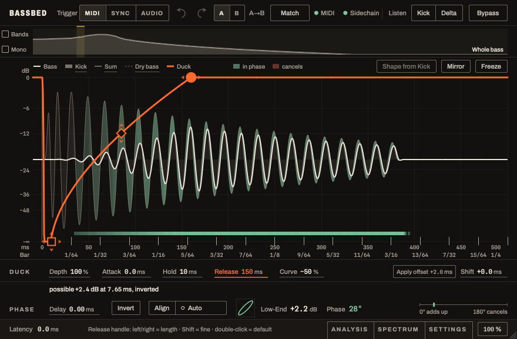
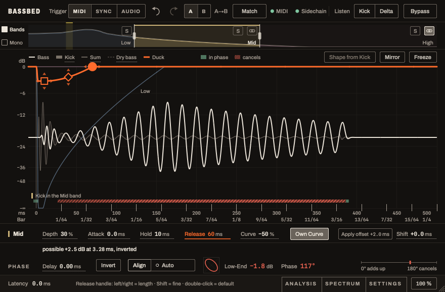

# Bassbed manual

The reference for every control, display and measurement. For the three steps a normal session needs, the test status and the known limits, read the [README](https://github.com/Teddish/Bassbed#readme) first; most of what follows you will only need when you want to know exactly what a number means.

**Contents:** [Usage](#usage) · [Interface](#interface) · [Ducker](#ducker) · [Alignment](#alignment-since-v03) · [Bands](#bands-since-v04) · [Which trigger?](#which-trigger) · [Setting up the MIDI trigger](#setting-up-the-midi-trigger) · [Sync and host delay](#sync-and-host-delay-since-v094) · [Limits with very dense triggers](#limits-with-very-dense-triggers) · [Reading the displays](#reading-the-displays) · [Waveform per hit](#waveform-per-hit) · [Spectrum](#spectrum) · [Measurement parameters](#measurement-parameters)

## Usage

The short version is the [Quick start](https://github.com/Teddish/Bassbed#quick-start) in the README. In detail:

1. Put the plugin on the **bass track**.
2. Choose the trigger in the header (MIDI / SYNC / AUDIO):
   - **MIDI** (default, recommended): route the kick MIDI notes to the plugin (see below). No sidechain needed for the duck itself, no latency.
   - **Sync**: ducks on the grid (note rate), follows the host tempo, also with the transport stopped. No latency. **Not recommended in Live for now**, see [Status](https://github.com/Teddish/Bassbed#status) in the README.
   - **Audio**: kick track as sidechain; the onset is detected in the signal (10 ms latency since v0.17.0, before 5 ms; compensated by the host).
3. For the **waveform** and the **measurement**, route the **kick track as sidechain** in every trigger mode (in Ableton, open the sidechain section of the plugin device and pick the kick track). Without it the display shows only the bass and the duck curve, and Align, Auto, tracking and the hints have nothing to measure. The dot before "Sidechain" in the header is green when the kick arrives.
4. Optional, for checking: the **ANALYSIS** tab at the bottom opens the measurements per hit (the phase row shows the average of the last 8 valid hits), **SPECTRUM** the pitch of kick and bass over time.

### Interface

*Whole bass, one curve (v0.20.1, synthetic test signals): kick and bass add up almost everywhere, so the area between them is green.*

*Bands on, Mid selected: the strip at the bottom is red hatched where kick and bass cancel, the status line says what aligning would gain.*

- **Header:** trigger, undo/redo, A/B comparison with **Match**, status (green dot = MIDI or sidechain arriving, yellow ring = missing but needed), the group **Listen: Kick | Delta** and, set apart, **Bypass**. **Delta** (hear only what ducking removes from the aligned bass; silence at depth 0 %; not saved and off when a project is opened), **Kick** (hear the sidechain kick instead of the bass, timed as in the mix; with **S** on a band only the kick in that band, through the same crossover as the bass. The kick track itself keeps playing in the mix: mute it there or solo the bass track. Kick plays at its sidechain level, unaffected by Output and Bypass. Kick and Delta exclude each other; not saved).
- **Display:** bass after ducking (bright), kick (grey area), duck curve (orange). The legend on the left also toggles the traces: *Kick*, *Sum*, *Dry bass* (dashed, off by default). On the right the buttons **Shape from Kick**, **Mirror** and **Freeze** (holds the waveform). **In-phase area** (since v0.4.4): the area between kick and bass is **green** where the two add up and **red hatched** where they cancel (legend *in phase* / *cancels*) (computed in the analysis band over about one period); the narrow **strip** at the bottom shows the same over time. This shows *when* it flips, e.g. when the bass is slightly out of tune. Where the bass is ducked away, neither is coloured (the colour fades out from −24 dB duck gain and is gone at −42 dB). **Shape from Kick** (since v0.16.0) sets curve and bands from the kick's fundamental in one undo step, see *Shape from Kick* below; until v0.15.0 it took hold and release from the kick's decay. **Mirror** turns the curve upside down: the bass is loud where it would otherwise be ducked, and quiet elsewhere (gain = 1 − duck gain; normal + mirrored gives exactly the original). Handles and curve are mirrored as well; the square then sits at the height of the depth. The switch is a parameter (automatable, saved with the project, undo and A/B); switching crossfades over 10 ms. When mirrored, the analysis counts from the start of the duck, weighted by how audible the bass is (the analysis then says "in the duck"). The dB scale on the left applies only to the duck curve (0 dB at the top, −∞ at the bottom, continuous without a kink); the waves are drawn relative. Horizontally: milliseconds from the trigger and, below, note values at the host tempo. Since v0.4.4 the result appears only in the phase row.
- **Handles on the curve:** square = depth (up/down) and hold (left/right), diamond = curve shape, circle = release length. You can also grab the curve itself: in the hold part like the square, in the release like the diamond. Shift = fine, double-click = default value. Arrows show the drag directions (always on first open, afterwards on hover). The values appear in the matching field of the control row, which is highlighted in orange.

Since v0.4.2 the interface follows the workflow from top to bottom: **1. set the bands** (band strip) → **2. curve per band** (display and context row) → **3. align the phase** (phase row).

- **Band strip** (below the header): on the left the boxes **Bands** and **Mono** (filled = on). Next to them the frequency axis 20 Hz–20 kHz with the zones LOW / MID / HIGH in their colours; inside, the spectrum of the bass *before* ducking as a line in the band colour and the spectrum of the kick (sidechain) as a grey line, averaged over about 300 ms. This shows where bass and kick overlap and where the crossovers belong. **Clash display** (since v0.5.1, replaces the yellow bracket from v0.4.5): highlighted in yellow are the ranges between 30 and 300 Hz (on a 1/6-octave grid, which is finer than hearing: at 50 Hz a hearing filter is about 30 Hz wide) where kick and bass overlap in the first 150 ms after the hit, with the bass as it sounds after ducking. Whatever the ducking already removes does not appear. The stronger the area, the stronger the clash; where the area is wide enough, the word *Clash* stands in it, so the display does not rely on colour alone; a range stays visible for a few seconds and only disappears when the clash stops. The tooltip gives the measured range, width and level difference, then a rule of thumb (since v0.15.0; not from a listening test). The width is in ERB, the width of one hearing filter, 24.7 × (4.37 × f / 1000 + 1) Hz (below 100 Hz an extrapolation, measured filters there are about 30 Hz). An octave is 1.3 ERB at 40–80 Hz and 3.1 ERB at 150–300 Hz, so a width in octaves meant something different at each height. **Wide** (from 2.5 ERB) → adjust the ducking rather (depth, hold, release). Otherwise it depends on who needs the range, judged by whether it holds a track's main energy (within 4 dB of its strongest point between 30 and 300 Hz): **both** → an EQ would take it from one of them, so try ducking, tuning or the crossover; **not the bass** → a dynamic bell on the bass track with the kick as sidechain can help, depth by ear; **the bass but not the kick** → an EQ on the kick can help, not one on the bass. Bassbed itself does not change the sound there. Limit: the window of 150 ms is about 13 Hz wide at −6 dB, and each band looks at 1/3 octave. A single sine therefore already shows as 0.6 to 1.7 ERB, a range about 1 ERB wider than it is, and below about 60 Hz neighbouring bands blur. Crossover frequencies and the dashed mono limit can be dragged directly (the value appears when the mouse is over the line and while dragging, Shift = fine, double-click = default). Clicking a zone selects the band whose curve the display and context row edit. Each zone has **S** (solo), Mid/High also the chain link (linked); the selected band has an edge in its colour at the top, depth and link state are in the tooltip. See *Bands*.
- **Context row:** on the left the selected band (colour bar and name; without bands "DUCK"), then depth, attack, hold, release and curve of this band, for Mid/High also **Own Curve**; on the right **Shift** (the trigger shift, shared by all bands). In front of it, depending on the trigger: with SYNC the **Rate** of the grid, with AUDIO the **Threshold** that decides which hits duck (both are the same controls as in SETTINGS and ANALYSIS; with *Auto measure* on, Threshold shows the measured value), with MIDI the button **Apply offset** when an offset was measured. Values with a dotted underline can be dragged vertically (Shift = fine, double-click = default, mouse wheel); **Alt-click** opens a text field to type the value (Enter or clicking elsewhere applies it, limited to the range; Escape cancels; one undo step). This works in all value fields, including PHASE, ANALYSIS and SETTINGS. The button **Apply offset +x.x ms** sits left of Shift and appears as soon as a MIDI→kick offset has been measured; a click applies it as trigger shift.
- **Status line** (between the context row and the phase row, directly above **Align**; below the display up to v0.18.0): one line with the current hint. A coloured bar marks hints (yellow) and confirmations (green); the target is in digits. Tooltip: the reasoning and how to read the figure.
- **Phase row:** bass delay, Invert (polarity), **Align | Auto** in one frame (left: align once now, right: automatically). When Auto sets the values, delay and Invert get a solid light underline (green up to v0.18.0). On the right the result: a **Lissajous figure** (kick horizontal against bass vertical, drawn from the measured phase: diagonal to the upper right = in phase, circle = 90°, diagonal to the lower right = cancellation). Bold is the average of the last hits, thin behind it each of the last 8 hits: if the thin ellipses lie on top of each other, the relationship is stable; if they scatter, the phase jumps from note to note (then a fixed alignment only helps partly). Next to it **Low-End** (sum of kick + bass, green from +2 dB, red on cancellation) and **phase** of the last hits, with a scale from "0° adds up" to "180° cancels" on the right. The status ("aligned", "possible +x dB at …" or what Auto is doing) is in the status line directly above the row. As long as aligning would gain at least 1 dB more low end than now, **Align** is drawn brighter with a stronger frame (not while Auto is on). See *Alignment*.
- **Footer:** latency (yellow as soon as it is above 0), help line for the element under the mouse, the tabs **ANALYSIS | SPECTRUM | SETTINGS** (at most one open; SETTINGS: rate, repeat, OUTPUT, anti-click with TIME and SMOOTH, MIDI channel/note, latency reserve, mode (off, tracking, ring), ring), window size 90–200 %: steps in the menu, or drag the corner at the bottom right freely (aspect ratio fixed, whole percent; saved with the project, as is the open tab; older versions round to the nearest step).
- **Undo/redo:** every gesture in the plugin is one step (up to 100); automation does not count. **A/B:** clicking A or B switches between two settings (B starts as a copy), the arrow copies the current one to the other. Both slots are saved with the project; bypass is not part of them. **Match** (since v0.15.0) turns the louder version down to the quieter one while you compare, so that loudness does not decide. Play each version for at least 4 s with kick and bass running; until both are measured the level stays as it is. The button then shows how many dB are taken off right now, 12 dB at most. Changing a setting measures that version again. It is only for listening, like Delta and Kick: not a parameter, not saved, off when the plugin window closes, never active in an offline render or in bypass, and it changes no measurement. **A realtime bounce would include it**, so turn it off first. It measures the bass output only, as the average over up to 12 s against the bass before ducking, K-weighted after ITU-R BS.1770-4. That weighting takes 3.9 dB off 50 Hz and 8.3 dB off 30 Hz, so with different spectra (Bands) the number is rough, and it does not know what the rest of the mix does. Compare the same part of the song: a stretch without kick reads louder.

**Design (since v0.4.4):** a lab instrument that measures and then acts: warm graphite, **orange only for the intervention** (curve, handles, selected control), **green for results and arriving signals** (phase good, in phase, in tune, aligned, signal present; plain measured values are light, not green). Band colours steel blue (Low), sand (Mid), old rose (High). Capitals only for sections (DUCK, PHASE, tabs) and the trigger choice, otherwise normal case; numbers in a monospaced figure font.

### Ducker

| Control | Default | Meaning |
|---|---|---|
| Depth | 100 % | How far the bass is turned down. 0 % = measure only. |
| Attack | 0 ms | Time to the lowest point. |
| Hold | 10 ms | How long the bass stays down. |
| Release | 150 ms | Time until the bass is fully back. |
| Curve | −50 % | Shape of the recovery: negative = slow first, then fast (classic pumping); positive = fast first, then slow. Range −200 … +200 % (since v0.6; −100 % = x⁴, −200 % = x¹⁶: the bass stays almost silent until the last quarter of the release). Beyond ±100 % the plugin stores the rest in its own parameter "Curve Ext"; CURVE (±100 %) stays automatable as before, the extension is added on top. |
| Shift | 0 ms | Duck later (+, no latency) or earlier (−, costs latency) than the trigger. When dragging into negative values, the new latency is only reported on release (one compensation instead of many). With **Latency reserve** (SETTINGS: 0 / 2 / 5 ms) the plugin reports this latency permanently; shifts within the reserve then change nothing for the host. **Apply offset** enters the measured MIDI→kick audio value. Not to be confused with the measured *bass offset* in the analysis (since v0.3 the alignment compensates that). |
| Output | 0 dB | Level after the ducker (±24 dB), in the SETTINGS tab. |
| Rate | 1/4 | Grid for Sync and for *Repeat*. |
| Repeat | off | With MIDI/Audio: after every trigger, keep ducking at the note rate until the next trigger arrives. |
| Anti-click | trailing, 2 ms | *Off*: hard step, and SMOOTH does not soften it: the curve starts at the middle of its smoothed edge (half the depth with attack 0). *Trailing*: S-shaped crossfade from the trigger, no latency. *Leading*: crossfade before the trigger, costs the crossfade time as latency; with SMOOTH the curve is smoothed before the trigger as well (since v0.9.7). The time is adjustable (2–10 ms, SETTINGS → TIME); longer = softer onset. |
| Ring | off (amount 0 %) | Alternative to ducking (since v0.7, SETTINGS → **Mode: Ring**): the bass is turned down **sample by sample** wherever the kick in the low band is loud, instead of being ducked for the whole kick. Between kick hits and in their quiet parts it stays audible. Technically this is amplitude modulation, not ring modulation: the factor stays between 0 and 1, so the bass remains as a carrier with sidebands around it (the name stays).  Set DEPTH to 0 % for this (both together also work: their effects multiply; at depth 100 % the ring then mainly lengthens the release, since the bass stays down until the kick falls below REFERENCE). **AMOUNT** 0–100 %, **REFERENCE** = kick level in the low band at which the bass is fully gone. The button **Reference from Kick** (since v0.15.0; only in Mode: Ring with the kick as sidechain, and not with MIRROR) sets it once to 6 dB below the kick's loudest peak in the last seconds, one undo step, and does not follow the kick afterwards. At amount 100 % the bass is then gone while the kick is within 6 dB of its peak and half back at 12 dB below it (where Shape from Kick ended its hold until v0.15.0). On 26 kick samples the bass starts coming back about 185 ms after the kick starts and is half back at about 235 ms, so check that this suits long kicks. **SMOOTH** = hold the peak this long, then fall back (0 ms follows the waveform and creates clearly more new tones around the bass; 10 ms ≈ half a kick period is cleaner). With BANDS the ring acts only on the low band, otherwise on the whole bass. The ring always starts just before the kick peak instead of on it, so it does not pop (since v0.11.0); this costs 5 ms latency unless the plugin already has that much (audio trigger, latency reserve). Projects from older versions with an amount above 0 % open in Mode: Ring, so they sound slightly different and in MIDI and SYNC mode gain these 5 ms. With low references and long SMOOTH check that the bass comes back between the hits. Works only with the kick as sidechain and not together with MIRROR (note in SETTINGS); Mode chooses either tracking or the ring. Measured on my own pairs (model, smooth 10 ms): peak of the sum as with ducking, about 6 dB more bass under the kick, new frequencies at −24 dB instead of −34 dB with ducking. In blind test 6 the preference depended on the material; ducking stays the default. Since v0.9.3 the display shows the ring as a dashed orange curve (legend **Ring**): what happens to the bass at the hit shown (with BANDS to the low band), duck curve times ring, measured from the kick of that hit and averaged over 5 ms; AMOUNT and REFERENCE apply immediately, SMOOTH from the next hit. The bass waveform in the display includes the ring as well. |
| Smooth | 3 ms | Rounds the corners of the duck curve (onset, hold → release, end of release), symmetrically and without latency; the timing of the corners stays. Against clicks on deep basses, especially with attack 0 and steep curves (SETTINGS → SMOOTH). |
| MIDI channel / note | all | Only certain channels or notes trigger. |
| Bypass | off | Click-free switch to the unprocessed signal (also via the DAW's bypass). |

The current **latency** is shown on the left of the footer (yellow as soon as it is above 0: audio trigger, leading anti-click or negative trigger shift). If it changes during playback, the plugin fades the bass out and back in within 30 ms instead of jumping (15 ms each way). The bass between the old and the new delay is lost in that moment: when the latency drops, that stretch is never played, up to 360 ms when leaving Tracking at +360 ms. So do not automate the switches that change the latency (Trigger, the Anti-click mode, Mode, the Tracking window, Latency reserve): every step costs one such fade and makes the host realign its tracks. A switch takes effect at once, also while Shift or TIME is being dragged (since v0.19.1); only the dragged value itself waits for the release. Likewise, curve changes during a running duck are crossfaded over 10 ms so that dragging the handles does not crackle.

**Typical setup with a sidechain plugin:**

| Position | Purpose |
|---|---|
| Instance A before the sidechain plugin | measures the starting point |
| Instance B after the sidechain plugin | shows what is left after shaping and latency |

If A and B differ in *offset*, the chain in between delays without compensation.

### Alignment (since v0.3)

First the bass is ducked, then it comes back during the release while the kick is still decaying. That is exactly where both should be in phase; then they add up instead of cancelling.

1. Route the kick as sidechain and play a few bars (the last 8 hits are averaged).
2. Click **ALIGN**. The plugin sets delay and polarity so that kick and returning bass sum loudest. Undo with the arrow at the top. With **AUTO** this happens by itself: after switching on and after every change to curves, bands, trigger or mono, once as soon as 4 new hits are in (one undo step). After that the value stays put until something changes again, so every bounce sounds the same. AUTO works while the plugin window is open. AUTO applies the change only while the bass is ducked (below −30 dB, at low depth at the lowest point of the curve) so that it cannot be heard. The four bars in the AUTO button show how many of the 4 hits are in; a solid light underline at Delay and Invert means Auto sets these values. Changing either of them by hand while AUTO is on switches AUTO off (same undo step, note in the phase row), so that hand and automation do not work against each other. AUTO only switches during playback: when rendering offline (bounce, freeze) and with the transport stopped, a pending change waits for the next playback, so that a bounce sounds exactly like the playback before it (since v0.5.0).
3. On the right of the phase row, **Low-End** and **Phase** show the result in the measured range, with a scale from 0° (adds up) to 180° (cancels). It starts as soon as the reduction is complete, independent of the trigger shift, and weights every point by how audible the bass is there (full from −20 dB, not at all below −26 dB). At full depth that is the release; at lower depth (about 70 %) hold counts too, because the bass still sounds under the kick there. With a tab open, the range is highlighted.

| Control | Default | Meaning |
|---|---|---|
| Delay | 0 ms | Delays the bass before ducking (0–20 ms). Since v0.20.0 the delay is applied in whole samples, so the bass passes bit-exact including its highs; up to v0.19.3 a fraction of a sample was interpolated, which cost up to 2.5 dB at 15 kHz and, with tracking, changed from hit to hit. Half a sample is 10 µs at 48 kHz, or 0.2° at 55 Hz. The duck curve stays with the kick. **No latency.** |
| Invert | off | Inverts the polarity of the bass. Together with the delay, at most half a period is then needed to align a bass that is "too late". |

**Shortest position (since v0.5.2):** ALIGN and AUTO search only up to half a period of the kick fundamental plus 1 ms (10.1 ms at 55 Hz, 15.3 ms at 35 Hz) and take the shorter delay when results are almost equal (within 0.05 dB). With polarity this reaches every phase, while the bass shifts as little as possible against the beat. By hand you can still go up to 20 ms. Existing projects keep their stored value; only a new ALIGN (or AUTO after a change) picks the shorter position. Delaying only the low band was tested and rejected: a comb filter appears at the crossover and the bass sounds thinner.

Why delaying also helps when the bass is already late: a sub is almost a sine. 1.5 ms late at 55 Hz is the same as half a period minus 1.5 ms early with inverted polarity. So the plugin delays by 7.6 ms and inverts instead of pulling the bass forward (which would cost latency). The onset moves into the ducked time and cannot be heard.

Limit: if the bass plays a different note than the kick's fundamental, the phase keeps turning with the frequency difference. A fixed setting then only matches the loudest part of the release; that is what tracking (below) is for.

**When no fixed delay helps (since v0.12.0):** ALIGN picks the loudest sum, not 0° phase. If every delay in the search range sounds practically the same (less than 0.2 dB between the best and the worst position, typically with a walking bassline, where what one note gains the next one loses), the phase row says "no fixed delay helps here", ALIGN is switched off and AUTO leaves the delay alone. The phase number then is an average over hits that disagree, so a delay that shows 0° is not louder for it.

**Tracking with lookahead (since v0.5.3):** in SETTINGS, **Mode: Tracking**. When selected, the plugin picks delay and polarity anew for **every hit**, measured over the first 200 ms (default step) in which the bass comes back after the duck (below about 95 % depth the bass never goes away, so hold and the kick's attack count too; with a tab open the display shows the range as *Tracking window*). It deviates from the fixed setting (ALIGN/AUTO) only if that gains at least MIN. GAIN in this hit (default 0.1 dB). It switches while the duck of the low band is closed, with a 2 ms crossfade. If something is still audible there (mid and high with BANDS, or a depth below about 95 %), the crossfade takes 10 ms; at depth 0 % it switches right at the hit, which is the audible case. It helps most on rolling basslines whose phase changes from hit to hit (on my own test pairs +0.50 dB on average instead of +0.15 dB fixed); with an offbeat bass it stays at the fixed setting. Costs **260 ms latency** by default (the DAW compensates it; best switched with the transport stopped) and needs the kick as sidechain. With a very long release tracking measures with a shorter window. With BANDS or MONO on, tracking takes the phase of the crossover into account. **Since v0.13.1 tracking really works with BANDS and at depth 0 %. Up to v0.13.0 it had no effect on the sound there, even though the display showed an improvement. Projects with these settings, with MONO, or with a depth below about 95 % sound different now.** **Since v0.13.2 the choice no longer depends on where playback starts, so bounce and playback pick the same positions. Before, they could differ by up to 0.09 ms; projects with tracking can differ minimally from earlier versions.** With kicks whose pitch still glides through the first 100 ms and that ring long afterwards, the 100 ms step can pick a position that suits the window but not the long tail; for such kicks use +360 ms. **Switching the mode during playback** changes the latency; the DAW then realigns its tracks, which can click. The plugin itself fades over 30 ms; for a clean switch, stop the transport. **Latency steps (since v0.9.0, default +260 ms since v0.14.0; projects from before v0.9.0 stay at +150 ms):** next to the switch you pick how much latency tracking may use. The longer it measures after the bass returns, the better it decides: +150 ms measures 100 ms (own test pairs +0.40 dB on average), +210 ms measures 150 ms (+0.48 dB), +260 ms measures 200 ms (+0.50 dB), +360 ms measures 300 ms, the whole kick tail (+0.65 dB); fixed alignment gives +0.15 dB. From +260 ms up no pair gets worse than that; at +210 ms one does, at +150 ms three. Pick the most latency you accept. Switch with the transport stopped; the preview below uses the chosen window. **Recording:** while you record or play live through the plugin, switch lookahead off; in MIDI and Sync mode the plugin then runs with zero latency. Turn it back on for mixing, where the DAW compensates the latency. Since v0.5.4, LOW-END/PHASE, the history per hit and the analysis use the position chosen for each hit, since v0.5.4.1 the waveform as well (bass, in-phase area, Lissajous).

**Follow pitch (since v0.18.0, experimental):** SETTINGS → Mode row → **Follow pitch**, off by default. Only with Mode: Tracking at **+360 ms**, the kick as sidechain and Mirror off; it adds no latency of its own. On top of the position tracking picks, it pulls the phase of the bass below 120 Hz to the phase of the kick while the kick is loud (from 25 ms after the hit, back by 280 ms), so bass and kick stay in phase even when their notes differ. That bends the pitch of the bass during the kick, mostly by about a semitone, at its peak often by several semitones and on a third of my test hits by more than an octave. It acts per hit, only where it gives more low end in the first 150 ms. **Why it is there:** tracking can only shift the whole bass, which helps little when bass and kick are far apart in pitch. Measured through the plugin on 300 kick/bass pairs (low-end sum below 120 Hz, 0–300 ms after the hit): +0.80 dB over a fixed alignment instead of +0.27 dB with tracking alone, and +0.75 to +0.90 dB in every pitch distance, where tracking alone gets +0.11 to +0.68 dB (the model behind it said +0.85 dB; v0.18.0 measured +0.69 dB; since v0.19.0 the ramps lead to the nearest in-phase point instead of through anti-phase, which fixed the few hits where it cost low end, and the first hit after loading is no longer skipped). The kick loses nothing (partial loudness, 120 further pairs, at most 0.06 phon), but the bass below 150 Hz sounds about 0.7 phon quieter: the extra level is heard as part of the kick. In my one blind test at equal loudness I heard no preference, and artefacts where the pitch moved 14 semitones. So listen before you keep it. **Stereo:** Follow pitch works on the mono sum below 120 Hz. The pull is computed from the average of both channels and added to both alike, so a mono bass is not affected, but a bass that sits on one side or is wide down there moves towards the centre: a bass on the left only also appears on the right, about 4 dB lower. If the bass is not mono below 120 Hz, switch MONO on or leave Follow pitch off. **What it did (since v0.19.0):** next to the switch, SETTINGS shows the gain over the last hits and how many of them it took ("+0.4 dB · 12 of 16 hits"; the gain is the low-end sum below 120 Hz from 2 ms before to 300 ms after the hit, with the duck curve, hits it skipped count as 0 dB), and the waveform shows the bass with the pull, with a "Follow" bar where the ramp sat (25 to 280 ms after the hit). Both come from a shadow of the same computation in the editor, fed from the input taps; a negative number is possible and real (the choice looks only at the first 150 ms).

**Minimum gain (since v0.12.0):** SETTINGS → Mode row → Min. Gain, 0–6 dB in steps of 0.1 dB, default 0.1 dB (1.0 dB up to v0.13). Tracking leaves the fixed setting only if a hit gains at least this much. Projects saved since v0.12.0 keep their value; older ones load with 1 dB. On my own test pairs, going from 1 dB to 0.1 dB changes the average low end from +0.40 to +0.40 dB at +150 ms, +0.43 to +0.48 dB at +210 ms, +0.46 to +0.50 dB at +260 ms and +0.52 to +0.65 dB at +360 ms, and about three times as many hits move. On 600 other pairs, at +360 ms no pair got worse by more than 0.05 dB, at the default +260 ms 0.2 %, at +150 ms about 4 %. With +150 ms and a bass playing between the kicks, raise it to about 1 dB: one of my offbeat tracks loses 0.26 dB at 0.1 dB. These are measurements; whether more frequent changes sound better is for your ears. The tooltip over each hit in the history shows the delay tracking chose for it, and the gain it expected.

**Layered kicks on the MIDI track (since v0.13.1):** MIDI notes less than 10 ms apart count as one hit, so a kick played by several notes triggers the duck and tracking once. Notes further apart stay separate hits.

**Which method, and is tracking worth it here? (since v0.14.0)** The plugin compares the three methods in the background on your own kick and bass, over the last 16 hits, and names the result in the line next to the method: "method makes no difference here", or "best method here: by coherence". Since v0.20.0 the comparison only runs while SETTINGS is open, so after opening the tab the line needs a few hits. A method other than energy is only suggested if it clearly improves the phase match without costing level or larger jumps; the rule was checked on hits it had not seen, not by ear. At a MIN. GAIN of 1 dB the three methods pick almost the same positions. At the default of 0.1 dB they differ on more hits, but on my test pairs another method was only suggested for about 1 to 10 % of the pairs, most often with a long duck, so "by energy" is the usual answer. While tracking is on, the status line says when it does not pay off: "a fixed delay is enough here" (tracking adds less than 0.1 dB over the best fixed delay; on my test pairs it then added about 0.01 to 0.04 dB in the output), or that the bass is too far from the kick. Tracking works best with the bass within about 3 semitones of the kick's fundamental (about +0.45 to +0.74 dB there, +0.1 to +0.2 dB further apart).

**Shape from Kick (since v0.16.0):** With the kick as sidechain and about 8 hits with a clear fundamental, the button **Shape from Kick** above the display sets the duck from the kick's fundamental, in one undo step: low band attack 0, release 25 ms, steep curve (−100 %), hold 80 ms below 47.5 Hz and 90 ms from there up; Bands on with the low crossover at three times the fundamental, mid with its own curve 20 ms shorter, high above 2 kHz fully ducked but held only 20 ms. Depth stays. It replaces the v0.15.0 button *Duck below … Hz* and the old decay-based shape. The crossovers delay the bass at the fundamental by a few milliseconds (3.5 ms at 50 Hz, 4.3 ms at 40 Hz), so align again afterwards or use Auto. Not in Ring mode and not with Mirror; the measurement does not cover them. **Why these values:** the goal was that the kick loses nothing against the plain duck (default settings, no bands). Measured with a partial-loudness model (offline, kick against bass, 0–64 and 64–200 ms after the hit, below 150 Hz and over the whole band): with the hold at 80 ms the kick lost more the higher its fundamental (66 kicks × 24 bass lines), so higher kicks get 90 ms; the kick's decay did not predict the best shape. Shorter mid bands or undamped highs let the bass cover the kick's body or attack. On 400 further kick/bass pairs not used for choosing: the kick stays within 0.1 phon of the plain duck in every window and with rolling, offbeat, mid-range and sparse bass lines; the bass gets +0.32 dB level and sounds about 1 phon louder; the low-end sum gains +0.05 dB at the old alignment, +0.09 dB realigned, +0.15 dB with tracking. With an offbeat bass the windows right after the hit get less bass (−0.5 dB), because the crossover delay moves the tail of a note across the hit into the duck; over the whole file it is −0.1 dB. Without bands the same low-band curve gives a little more level (+0.38 dB) but the bass sounds no louder (+0.1 phon). Measured, not listening-tested.

**Comparing methods by ear (since v0.13.1):** SETTINGS → the Mode row offers three methods. *By energy* (default) picks the loudest sum of kick and bass. *By coherence* picks the best phase match, with loud moments counting more (+1 = in phase, 0 = 90°, −1 = cancels). *By correlation* works like energy, but a louder bass alone does not count (+1 = same shape, −1 = opposite). The switch also sets what the displays show: the value next to Phase, the bars in the analysis and their tooltip, the phase and Lissajous figure, the expected gain in SETTINGS, and how strongly the waveform is coloured in phase or cancelling. Coherence and correlation do not depend on the overall level of the bass; Low-End does. ALIGN and AUTO always use energy, and so does their "possible" value. MIN. GAIN uses the same scale for all three, so they move about equally often. The choice applies from the next hit and, since v0.14.0, is saved with the project (and in A/B and undo); older projects load as energy. These are tools for comparing: no listening test has shown yet that one predicts what you hear better than Low-End. On my test pairs the three differ by only about 0.01 dB of Low-End at +360 ms.

**Is tracking worth it here? (since v0.5.4)** With the switch off, the window computes what tracking would have gained over the last 16 hits and shows it below the switch: "Tracking would gain about +0.3 dB in its window", or below 0.2 dB "not worth it here". It is the same calculation as in the plugin; the audio thread does nothing extra for it. When on, it shows the running status there (and in the footer): "Tracking: 9 of 16 hits off the fixed setting, +0.3 dB in the window". The count says how often the chosen position differs from ALIGN/AUTO, not whether tracking helps: a hit whose best position is the fixed setting does not count. So the count can change with the fixed setting while Low-End stays the same. The dB value is the gain tracking expects inside its window; **Low-End** in the phase row measures the whole range after ducking, so the two can differ.

**With MIRROR:** the mirrored instance makes the same decisions and switches at the same moments as the normal one. So "normal + mirrored = original" holds with tracking as well. Used on its own, the mirrored instance therefore switches during the loud part (2 ms crossfade).

**Note:** AUTO, the preview and all displays (LOW-END/PHASE, analysis, spectrum, clash) only compute while the plugin window is open. After opening it takes a few hits until values appear. The sound does not depend on it: ducking, fixed alignment and tracking always run.

**Tuning hints (rules since v0.12.0):** the phase row shows at most one tuning hint, in this order. The tooltip over the result gives the same hint with its reasoning. They count the same hits: the last 16, and only those since the kick last changed pitch. The rules assume that a synth bass sits on the scale and the kick is a sample you can tune freely.

1. **Kick and bass on the same note but at least 10 ct apart** (within half a semitone and less than 3 Hz apart, from at least 3 hits and at least half of the hits). If the kick is on the scale, the hint names the synth: "Bass −25 ct from the kick → synth tune +25 ct". Otherwise it names the kick, as a frequency and note, because a cent value relative to the current pitch is easy to overshoot in a sampler: "Kick +39 ct off F#1 → kick to 48.6 Hz (G1 −13 ct)". The kick target is the note itself when the bass is within 10 ct of it, otherwise the bass. If fewer than half of the hits are on the kick's note, this appears only in the tooltip, with the share ("3 of 8 hits on the kick's note: …").
2. **The bass beats against the kick** (more than 3 Hz apart, the phase turns within the hit, and no delay keeps them in step; on my own test pairs, with tracking, such hits gain +0.2 to +0.3 dB instead of +0.6 to +1.1 dB). If at least half of the hits beat and tuning the kick to a note the bass plays (at most a fifth away, the most played one on a tie) would free at least a quarter more of them, the hint names it: "Bass beats against the kick in 16 of 16 hits → tune kick to 51.9 Hz (G#1)". With a walking bassline that no kick tuning helps, the count appears only in the tooltip.
3. **All bass notes off the scale together:** if at least half of the notes lie within 10 ct of their median, unless the kick is tuned the same way: "All bass notes −16 ct out of tune (most hits −19 … −14) → synth tune +16 ct". The range shows how far you can trust the value.

**After tuning (since v0.9.5, for all three hints since v0.12.0):** for 60 s after a hint, the phase row follows up. A hint disappears as soon as the last hits fit, and a green line confirms for 5 s: "Kick in tune with the bass (48.7 Hz, 8 ct apart)", "Kick on target (51.9 Hz, G#1)" or "Bass notes on the scale (−3 ct)". If the kick lands on another note instead, it names the current pitch and the target. A pitch jump of the kick counts from the second hit on the new pitch; older hits are then ignored.

The tooltip of each hit in the history adds the **deepest dip** (sum against the single levels, 0 dB = no cancellation; after alignment typically around −3 dB, with beats −8 to −10 dB).

## Bands (since v0.4)

With **BANDS** (on the left of the band strip) the bass is split into three bands (Linkwitz-Riley, 24 dB/oct). Each band has its own duck curve:

- **Low** is the existing curve.
- **Mid** and **High** are **linked** by default: they follow the low band's curve, only their DEPTH is their own (share of the low band's reduction; 0 % = they stay, overtones remain audible). With **Own Curve** (context row) or the chain link in the strip the band gets its own attack, hold, release and curve shape. When unlinking, the own curve starts as a copy (the sound does not change); when linking, the share is set so that the depth stays the same. Both are one undo step.
- Clicking the zone in the band strip selects which band the context row, curve and handles edit. The curves of the other bands are drawn thin in the background. For linked bands ATTACK/HOLD/RELEASE/CURVE edit the shared times of the low band. SHAPE FROM KICK acts on the selected band and uses the kick *in that band*: for MID often clearly shorter than for LOW, because the mid part of a kick decays faster. A linked band is unlinked in the process (together one undo step). For MID the display shows the kick wave after the crossover, for HIGH its envelope on the curve's dB scale (peak = 0 dB), so that the curve can be laid right next to it.
- Tip: mids with their own release, about half as long, bring the bass back to presence earlier while the foundation still leaves room for the kick.

| Control | Default | Meaning |
|---|---|---|
| BANDS | off | Off: the whole bass is ducked, without crossover, bit-exact as before. During playback, BANDS and MONO switch inside the next closed duck (at the latest after 2 s), because crossfading through the crossover would briefly cancel the bass at the crossover frequency; with the transport stopped they switch at once (since v0.9.7). |
| Crossover Low/Mid | 120 Hz | drag in the strip (40–300 Hz) |
| Crossover Mid/High | 1 kHz | drag in the strip (300 Hz – 5 kHz) |
| Chain link / OWN CURVE | linked | linked: mid or high follow the low band's curve; own curve: own times |
| DEPTH (band Mid/High) | 30 % / 0 % | linked: share of the low band's reduction; own curve: depth of the band |
| S (solo) | off | Hear only this band (for setting up). Not saved, always off when opened. |
| MONO, green line | off, 150 Hz | Bass below the limit in mono (independent of the bands), drag the limit in the strip (40–300 Hz) |

Good to know:
- The crossover rotates the phase of the bass like an allpass and so delays it, even at a reported latency of 0. Measured through the plugin with the default crossovers (120 Hz, 1 kHz) from 40 to 80 Hz: the phase is 4.3 to 4.6 ms late, the envelope (group delay) 4.6 to 5.0 ms, and towards very low frequencies both approach 2√2/(2π f_c) per crossover, together 4.2 ms. A lower crossover delays more: 7.5 ms phase and 8.1 ms group delay at 50 Hz with a crossover at 71 Hz. MONO adds its own (3.1 to 3.2 ms phase, 3.2 to 3.6 ms group delay at 150 Hz). So after switching it on, **ALIGN** once (the analysis includes the crossover; in the test the output was within 1° afterwards). Because Linkwitz-Riley bands are in phase, ducking does not change the phase: the alignment holds through the whole release.
- At depth 100 % with the crossover at 120 Hz, the fundamentals are reduced by about 25 dB (60 Hz) to 38 dB (40 Hz), not quite to silence. For complete silence under the kick: bands off, or duck the mids along at 100 % depth.
- On/off, solo and mono crossfade over 10 ms, crossover frequencies glide: no crackle when switching or dragging.
- MIRROR works per band: normal + mirrored gives exactly the signal after the crossover with bands too.

### Which trigger?

**Recommendation: MIDI trigger.** MIDI has no detection delay and hits every beat reliably. Sync does the same for kicks on the grid in principle, but in the one host I have tested (Live) it currently comes with a delay, see [Status](https://github.com/Teddish/Bassbed#status) in the README and *Sync and host delay* below; leave it for now. The audio trigger first has to detect the onset in the signal. When detection takes longer than the latency it reports, the duck starts that much after the kick in the mix, always with the whole curve (since v0.9.6; before, the curve was cut at the front) and, since v0.15.0, independent of the host's buffer. The audio trigger is worth it when no MIDI notes exist, e.g. with bounced drum loops. It needs a clean kick track: with other low sounds on the sidechain (bass 20 dB below the kick or louder) no threshold separates them reliably.

**If the audio trigger misses the kick:** usually the kick is too quiet for the threshold. The bottom row of the **ANALYSIS** tab holds **Threshold**, **Lowpass** and the *Kick level* meter with the threshold as a line. With *Auto measure* on, both values follow the last hits while you play with the window open (see *Measurement parameters*); to set them yourself, switch Auto measure off, lower Threshold until the kick crosses the line, and raise Lowpass if the kick has little energy below it. In AUDIO mode the same Threshold control is in the context row.

**Why 10 ms latency and a lower automatic threshold (since v0.17.0):** I chose both because the audio trigger now detects the kicks much more reliably and on time. Up to v0.16.0 Auto measure set the threshold 18 dB below the kick and the trigger reported 5 ms. Measured through the plugin on 120 kick/bass pairs (66 kick samples, real bass lines, kick at 0, −12 and −24 dB): that threshold missed 30 % of the hits even on a clean kick track, and detection took 8 ms in the median, so only 6 % of the hits were detected within the 5 ms. Now Auto sets it 45 dB below the kick and at least 10 dB above the level before the hits: on a clean kick track 94 % of the hits are detected, in 0.3 ms in the median; with the 10 ms latency 94 % are detected within the latency, so the duck starts on the kick (78 % would be with 5 ms). With bass 30 dB below the kick on the sidechain, 91 % instead of 72 % are detected, at the price of 42 extra triggers on 1,920 hits (the old setting had none; 10 instead of 6 dB above the level before the hits halves them). The cost is 5 ms more latency in Audio mode only; Midi and Sync stay at zero. Projects in Audio mode report 10 ms after loading, and with Auto on the threshold is set anew on the next playback, so they duck differently, mostly on more hits. A bounce does not change the threshold. Measured, not listening-tested.

Important with MIDI: many kick samples have a few milliseconds of silence at the start. The **MIDI → kick audio** measurement shows this offset; in the ducker it can be compensated with the **Shift** control (button **Apply offset**).

### Setting up the MIDI trigger

MIDI alone is enough for ducking. The measurement also needs the kick sidechain, because it measures the kick audio; MIDI only provides the timing.

1. In Ableton, create a MIDI track. Under *MIDI From* pick the track with your sidechain plugin's trigger notes and set Monitor to **In**.
   (A MIDI track can send to only *one* destination. This helper track taps the notes for the second plugin.)
2. Under *MIDI To* pick the bass track and below it **Bassbed**.
3. At the top right of the plugin, the dot before "MIDI" lights up.

**Several instances from one MIDI track** (e.g. bass and synth bass on the same kick): in Ableton, put an Instrument Rack with several chains on the helper track and an *External Instrument* in each chain. Each External Instrument sends via *MIDI To* to a different Bassbed instance. Without this a MIDI track can send to only one destination.

**Parallel ducking with MIRROR:** instead of putting Bassbed on the bass track, send the bass track to a return track (pre-fader, level 0 dB), put Bassbed with **MIRROR** there, followed by a Utility with inverted polarity. Dry bass + return then gives the ducked bass. With several such returns you can combine different triggers (kick, snare) without plugin latencies adding up in series. The levels must match exactly (send 0 dB, no other effects), otherwise a residue remains.

| Trigger | Behaviour |
|---|---|
| **MIDI** (default) | Duck and measurement start at note-on. Reliable with rolls, ghost kicks and long sub tails. Without MIDI there are no hits. |
| **Sync** | Duck and measurement start on the grid (rate). |
| **Audio** | Duck and measurement start at the detected kick onset. If MIDI arrives as well, the MIDI→audio difference is still shown. |

**MIDI → kick audio** (button "Apply offset" in the context row): the time between note-on and the actual onset in the kick audio. Positive means the sample has an offset. By exactly this amount, MIDI-triggered ducking in other plugins also sits too early. On synthetic test signals the measurement is accurate to about ±0.05 ms (since v0.2: onset at the start of the slope instead of at 25 % of the peak; earlier versions showed about 0.25 ms too much).

### Sync and host delay (since v0.9.4)

Sync relies on the song position the host reports. Some hosts delay the plugin's input to line it up with a delayed sidechain, for example when the kick is taken *after* the effects of the kick track and those effects have latency, but do not move the reported position with it. The kick then arrives after the grid by that latency and the duck comes early (measured in one host: about 100 ms with a sidechain taken post FX). With the kick as sidechain, Bassbed measures this: if the kick sits evenly at least 5 ms off the grid over several hits, the phase row shows e.g. "Kick 100 ms after the grid → sidechain pre FX, or MIDI" (details in the tooltip). The sound is not changed. Remedies: take the sidechain before the effects of the kick track, or trigger by MIDI or AUDIO; both are not affected.

### Limits with very dense triggers

Some stages work with fixed buffers so that the audio thread never allocates. In normal use none of them fills up; with extreme trigger rates they do, and since v0.20.0 the plugin counts what it leaves out instead of dropping it silently (the counters are for tests and troubleshooting, not shown in the interface):

- **Follow pitch** works on 10 hits at a time, and a hit stays in work for about 700 ms. With hits closer than about 70 ms the oldest one loses its pull; ducking and tracking go on.
- **Tracking** takes at most 16 hits per host block. That only matters for very large blocks with a dense grid, for example an offline bounce in one block of 65536 samples at 1/64 and 999 BPM.
- **Duck starts:** up to 1024 can be waiting per curve.
- **Trigger positions per host block:** at least 4352, also when the host announces a small block and then sends a larger one (up to v0.19.3 the announced size decided, and a block of 65536 samples after announcing 1 lost triggers).

## Reading the displays

For the three steps of the [Quick start](https://github.com/Teddish/Bassbed#quick-start) the first two rows are enough; the rest describes the ANALYSIS tab, which is mainly there for checking.

| Value | Meaning |
|---|---|
| **LOW-END in the release** | Energy of kick + ducked bass relative to the sum of the individual energies, only in the range after ducking where the bass is audible again. +3 dB = equally loud and in phase, 0 dB = independent, negative = cancellation. **The most important number.** |
| **Phase in the release** | 0° = in phase, 180° = cancellation (determined independently of the envelopes). |
| **Possible** | Best LOW-END with the delay/polarity that ALIGN would set, in the phase row. |
| **Kick / On kick note** (header of the analysis) | Note, cents and Hz of the kick in its decay (median of the hits above), and how many of them have the bass on the kick's note, with the median distance in cents. The hints use the same values. A kick that is still gliding after 120 ms reads as its running pitch, above where it ends (on a test signal with 10 Hz still to fall over 250 ms, 105 ct above); many real kicks never settle, though: of 25 samples, 10 were still falling when they faded out. Note names alone can differ across a boundary: F#1 +38 ct and G1 −14 ct are only 48 ct apart. |
| **History** | Bars = LOW-END in the release per hit (red only below −1 dB, since the level that can be reached depends on the material), dots = phase (top 0°, bottom 180°; green below 30°, red from 90°), the same analysis as ALIGN. If the values jump in a pattern from hit to hit, the bass notes change: a fixed alignment then only helps partly. A flat grey line means the bass did not come back before the next hit. Above, per hit, the **kick fundamental** (row Kick) and the **bass note** in the measured range (row Bass), computed as in the spectrum. The bass note is determined periodically (YIN) so that overtones of saw or square basses do not distort it. It counts the note played in this hit: each note counts by level times duration, one already sounding before (decay) only half, and the pitch comes from the first 50 ms of the note (many synths drift in the decay). If a second note with at least 30 % share sounds, a small dash appears under the note (change, details in the tooltip). A bass on the kick's note is bright and gets a small mark above its bar; there a fixed alignment can hold. Other notes are dimmed: that is music, not a fault. The tooltip over a hit shows both notes with cents and Hz, the distance and LOW-END/phase; the tooltip over the header explains low end and phase. If space is short, names appear only where the note changes. |

### Waveform per hit

For every hit the display shows 10 ms before to at most 1 s after the trigger, like a triggered oscilloscope: standing still instead of scrolling, in the low band after the analysis lowpass and on a common scale. The capture ends at the next hit at the latest (at 125 BPM and quarter notes, after 480 ms). With long curves the time axis grows in steps (500 / 1000 / 1250 ms); it never shows less than 500 ms.

| Element | Meaning |
|---|---|
| Bright line | Bass after ducking |
| Dashed | Bass before ducking (*Dry bass*) |
| Grey line (*Kick*) | Kick sidechain, can be switched off |
| Light grey line (*Sum*) | Kick + bass. Where it is smaller than the kick alone, the two cancel. |
| Green / red hatched area, strip at the bottom | In phase: green = kick and bass add up, red hatched = they cancel (since v0.4.4; explained in the legend since v0.13.0) |
| Orange line | Duck curve (dB axis on the left) |
| Blue area *Tracking window* (with a tab open and Mode: Tracking) | Range tracking really measured in this hit. With full depth it starts where the bass comes back (from −26 dB); below about 95 % depth the bass stays audible, so it starts just after the reduction and also counts the hold and the kick's attack. A next hit can cut it short. |
| Lighter area *Measured* (with a tab open) | Range after ducking in which LOW-END and phase are measured |
| Marker *Onset* / *MIDI* (with a tab open) | Actual onset in the unfiltered kick, or MIDI note-on |

*Freeze* holds the current waveform.

**Hit detection (audio trigger):** a hit counts when the *unfiltered* kick rises by more than 4 dB within 10 ms and the low band is above the threshold. This also detects kicks whose decay is still loud when the next one arrives.

### Spectrum

The **SPECTRUM** tab in the footer opens the spectral view of the **last hit** (with *Freeze*, of the frozen hit; same time axis, frequency logarithmic 20–300 Hz, notes A0–A3 with Hz on the left).

| Element | Meaning |
|---|---|
| Bright area / blue area | Spectrogram of kick or bass (each can be hidden with the legend switch). The bass has a long window (at least 100 ms), so that its overtones stay steady lines, the kick a shorter one (at least 40 ms), so that its attack stays sharp; short events blur in time, which is what the pitch line is for. |
| White line | Pitch of the kick: the "hockey stick" from the attack into the fundamental, half wave by half wave from the zero crossings. If overtones distort those in the decay, the periodic measurement of the bass takes over there (since v0.12.0). |
| Blue dashed line | Pitch of the bass |
| Dotted horizontal | Kick fundamental (decay) and bass note in the measured range |
| Kick / Bass at the top right | Note with cents and Hz; for the kick also the highest pitch in the attack |
| Δ | Distance between the two in this hit, as a measurement: "in tune" (below 10 ct), "25 ct apart · beats every 1.3 s" or "6.0 Hz apart · phase turns every 167 ms". What to do about it is in the phase row, which looks at several hits. |

Notes: the view uses its own, wider capture (up to 400 Hz), because the kick's attack often lies above the analysis lowpass. A spectrogram fundamentally cannot show a drop within a few milliseconds sharply (time-frequency uncertainty); that is what the pitch line is for. It too averages over one half wave each, so the peak in the attack appears lower than the actual starting pitch.

## Measurement parameters

Since v0.3.2 there is only one analysis: the one in the release (see *Alignment*). The former controls Window, Offset and Max. Lag have been removed from the interface; they remain as parameters for older projects but no longer affect any display.

| Parameter | Default | Note |
|---|---|---|
| Auto measure | on | Sets Lowpass and Threshold from the last hits, while playing with the window open, like AUTO; a bounce does not change them, and the values are saved with the project. New instances start with it on, projects from older versions with it off and keep their values. Threshold: 45 dB below the typical kick level, at least 10 dB above the level before the hits, but always 6 dB below the quietest hit (until v0.16.0: 18 and 6 dB, see *Why 10 ms latency* above). If the audio trigger finds no hits although a kick is there, Threshold goes 12 dB below its level. Lowpass: 2.7 times the highest fundamental of kick and bass. A value only changes when it is clearly off (3 dB, 15 %). |
| Threshold | −30 dB | Kick level in the low band from which a hit is detected. The bright line in the *Kick level* meter next to it. |
| Auto pitch | on | Detect the pitch of the kick automatically (zero crossings, per hit). The fundamental in the decay is always measured regardless. |
| Kick Pitch | 55 Hz | Manual value. With *Auto pitch* the field instead shows the measured kick fundamental with its note (e.g. "55.0 Hz A1", cents in the tooltip); it cannot be dragged then. The manual value remains the fallback when nothing can be detected. |
| Lowpass | 150 Hz | Analysis band (LR4, identical on both signals). |

---

VST is a registered trademark of Steinberg Media Technologies GmbH.
