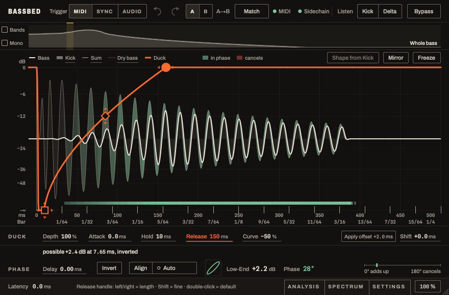
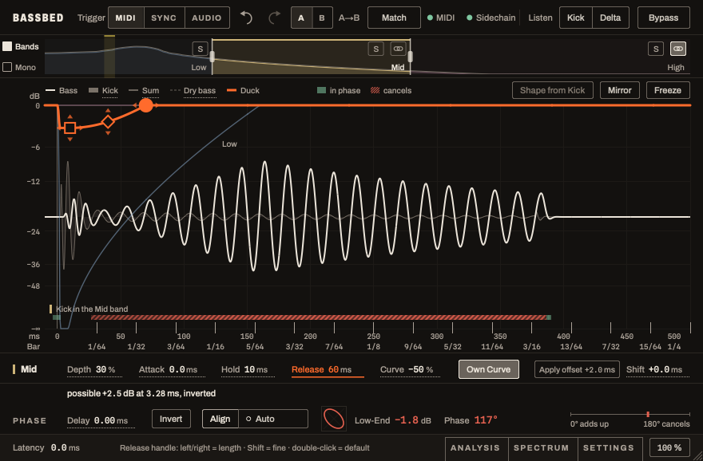

# Bassbed

A free kick/bass ducker with phase alignment, as a VST® 3 plug-in (VST3) for macOS, Windows and Linux and as an Audio Unit on the Mac.

Bassbed ducks the bass on every kick, triggered by the kick's MIDI notes or by the kick audio, in up to three bands. It shows where kick and bass cancel each other, and it can line up the phase of the bass with one click, so that the low end adds up instead of fighting. With MIDI as the trigger it runs with zero latency.

**[Download](https://github.com/Teddish/Bassbed/releases)** · **[Manual](MANUAL.md)** · **[Questions, bugs and feature requests](https://github.com/Teddish/Bassbed/issues)**

## Installing

Download the ZIP for your system from the **[Releases](https://github.com/Teddish/Bassbed/releases)** page. Each ZIP contains the plug-in, a README, the licence, the third-party notices and the manual.

Bassbed comes as a VST3 plug-in for macOS, Windows and Linux, and on the Mac also as an Audio Unit. There is no installer: you copy the plug-in into the folder where hosts look for it. `Bassbed.vst3` looks like one file on the Mac and is a folder on Windows and Linux; always copy it as a whole.

| System | Needs | Copy to |
|---|---|---|
| **macOS** | built for macOS 11 or later, Apple Silicon and Intel; tried only on Apple Silicon with macOS 26 | `Bassbed.vst3` into `~/Library/Audio/Plug-Ins/VST3/` and `Bassbed.component` into `~/Library/Audio/Plug-Ins/Components/` (for you only), or into the same folders under `/Library/Audio/Plug-Ins/` (for every user of the Mac) |
| **Windows** | Windows 10 or later, 64 bit | `Bassbed.vst3` into `C:\Program Files\Common Files\VST3\` |
| **Linux** | x86_64, glibc 2.38 or newer and the C++ library of GCC 13 or newer (for example Ubuntu 24.04, Fedora 39; Debian 12 is too old) | `Bassbed.vst3` into `~/.vst3/` (for you only) or `/usr/local/lib/vst3/` (for every user) |

**macOS**

1. Unpack the ZIP with a double-click.
2. The Library folder in your home folder is hidden. In the Finder choose *Go → Go to Folder…* (Shift-Command-G), enter `~/Library/Audio/Plug-Ins/` and drag `Bassbed.vst3` into `VST3` and `Bassbed.component` into `Components`. Create a folder that is missing.
3. Restart the host or let it rescan its plug-ins.

A release is signed and notarised, so macOS should open it without asking. If macOS says it cannot check the plug-in or that the developer cannot be verified, the file is not a notarised release: do not work around the warning. If the Audio Unit does not show up, log out and in again or restart the Mac; macOS keeps a list of Audio Units and does not always refresh it at once.

**Windows**

1. Unpack the ZIP (right-click, *Extract All…*).
2. Copy the folder `Bassbed.vst3` into `C:\Program Files\Common Files\VST3\` and confirm the question about administrator rights.
3. Restart the host or let it rescan its plug-ins.

The Windows build needs no separate runtime from Microsoft. It is **not code-signed**. Windows may therefore show a warning about an unknown publisher ("Windows protected your PC") when you unpack or first load it; choose *More info* and then **Run anyway**. If the host does not find the plug-in afterwards, right-click the downloaded ZIP, open *Properties*, tick **Unblock** and unpack it again. This build has not been tried in a host on a real Windows machine yet, so I cannot say which of these messages actually appears.

**Linux**

1. Unpack the archive.
2. `mkdir -p ~/.vst3 && cp -r Bassbed.vst3 ~/.vst3/`
3. Restart the host or let it rescan its plug-ins.

The build is made on Ubuntu 24.04. Measured on the file itself, it needs glibc 2.38 and libstdc++ from GCC 13 or newer, and these libraries: libX11, libXext, libXrandr, libXinerama, libXcursor, libXi, libXss, libfreetype and libfontconfig. A desktop system has most of them; libXss (package `libxss1` on Debian and Ubuntu, `libXScrnSaver` on Fedora) is sometimes missing. It has not been tried in a host on Linux yet.

**In the host.** The plug-in appears under the manufacturer **Teddish**. In Ableton Live, the only host tested so far, switch on the VST3 system folders (and Audio Units on the Mac) under *Settings → Plug-Ins* and rescan.

**Updating and removing.** Close the host and replace or delete the same files. Your settings are saved in the projects of the host; the plug-in identifiers do not change between versions, so projects find the new version by themselves.

## Quick start

Bassbed goes on the **bass track**. A normal session needs three steps; everything after this section is reference.

1. **Feed it the kick.** Route the kick track into the plugin's **sidechain**. The waveform display and every phase measurement work from this signal: without the kick audio Bassbed can still duck, but it cannot show or measure where kick and bass cancel. For the *timing* of the duck, the kick's **MIDI notes** are the best trigger (exact, zero latency, see [Setting up the MIDI trigger](MANUAL.md#setting-up-the-midi-trigger) in the manual). If you have no MIDI, the kick audio alone is enough: set the trigger to **AUDIO** (10 ms latency, compensated by the host).
2. **Duck in three bands.** Switch on **Bands**, drag the two crossovers in the band strip and give each band its curve; **Shape from Kick** sets a starting point from the kick's fundamental. The display then shows what is left between kick and bass: **green** where they add up, **red hatched** where they cancel.
3. **Fix what still cancels.** Either at the source, in the synth that plays the bass (start phase or retrigger of the oscillator, tuning), or directly in Bassbed: **Delay** and **Invert** in the phase row, or **Align**, which sets both for you. This fixed alignment costs no latency.

**If the kick is not detected in AUDIO mode.** Open the **ANALYSIS** tab: its bottom row holds **Threshold**, **Lowpass** and the **Kick level** meter, whose line marks the threshold. A kick that rises above that line is detected. *Auto measure* sets both values from the last hits while you play with the plugin window open, and it keeps the threshold well below the kick, so quieter hits between loud ones count too. If a kick is still missed, switch **Auto measure** off and lower **Threshold** by hand. Raise **Lowpass** if the kick has little energy below it (a short or high-pitched kick): the level is measured below the lowpass. One case remains: a quiet hit inside the long tail of the kick before it, when it barely rises above that tail. In AUDIO mode Threshold also sits in the context row under the display. Up to v0.20.3 a kick could be missed although it was above the line, and Auto measure pushed the threshold up to just below the kick; if AUDIO mode let you down there, try it again.

**What you can ignore.** Apart from these detection settings, the tabs **ANALYSIS** and **SPECTRUM** in the footer mainly exist to check what the plugin measures: the history per hit, the pitch of kick and bass, the spectrogram. I built them as test instruments. For normal use you can probably leave them closed; the display, the band strip and the phase row show everything the three steps need.

**What costs latency, and what changes the sound.** Ducking and the fixed alignment are free. Letting the plugin correct the phase by itself for every hit is not:

| Function | Latency | Good to know |
|---|---|---|
| Ducking with MIDI or Sync trigger, Bands, Mono, Delay, Invert, Align, Auto | 0 | With Bands or Mono the crossover still delays the bass by a few milliseconds that the host cannot compensate (see [Bands](MANUAL.md#bands-since-v04)). |
| Audio trigger | 10 ms | Needed to detect the kick in the signal. |
| Leading anti-click, negative Shift, Ring | up to 10 ms | Leading anti-click: its crossfade time (2 to 10 ms). Negative Shift: its amount (up to 5 ms). Ring: 5 ms. |
| **Tracking** (SETTINGS → Mode) | **150 to 360 ms**, default 260 ms | Picks delay and polarity anew for every hit. It has to look ahead to do that. |
| **Follow pitch** (on top of tracking) | needs tracking at 360 ms | Experimental. It does more than shift the bass: it actively reshapes the bass waveform below 120 Hz while the kick is loud. That bends the pitch of the bass and can change its tone. Listen before you keep it. |

The host compensates reported latency in the mix, but not while you play or record through the plugin: switch tracking off for that. The current value is always at the bottom left of the window.

## Status

> **Experimental, no warranty.** Test it yourself before using it in important projects, and back up your sessions.

- **Tested in one host only.** So far I have used Bassbed only on an Apple Silicon Mac, in Ableton Live 12 Suite. The Windows and Linux builds, and the Intel half of the Mac build, pass the same automated checks, but nobody has tried them in a real session yet. If you do, please tell me how it went.
- **Known issue: do not use SYNC in Live for now.** In Live there is a delay in Sync mode, so the duck does not sit on the kick. Trigger by **MIDI** or **AUDIO** until this is solved. I have reported it to Ableton; they can reproduce it and are keeping me informed.
- **The Windows build is not code-signed**, see *Installing*. The macOS build is signed and notarised; if macOS still complains, please open an issue.
- **Online only when you ask.** *Check for updates* in the About window (click the name in the header) asks github.com for the newest release, once per click. Nothing else is sent, and the plug-in never connects by itself. The Linux build does not go online at all.
- **How it was made.** I took care to research the technical approaches properly, but the plugin was built with the help of Claude Code, an AI coding tool. To keep that honest: every function is covered by automated tests with known target values, and every release is checked on macOS, Windows and Linux with [pluginval](https://github.com/Tracktion/pluginval) at strictness 10 and with the validator from the VST3 SDK.
- **Free, closed source.** Bassbed costs nothing and takes no payments. The source code is not public; this repository holds the downloads, the manual and the issue tracker.

## Questions, bugs, feature requests

I am available for individual questions and feature requests: please [open an issue](https://github.com/Teddish/Bassbed/issues). Bug reports help most when they are reproducible: host and version, operating system, Bassbed version, settings, and the steps that lead to the problem.

## Licence

Bassbed is freeware under the terms in [LICENCE.txt](LICENCE.txt). Third-party components and their licences are listed in [THIRD_PARTY_NOTICES.txt](THIRD_PARTY_NOTICES.txt).

VST is a registered trademark of Steinberg Media Technologies GmbH. Audio Unit and macOS are trademarks of their owner. Bassbed is not affiliated with or endorsed by the owners of these trademarks.
